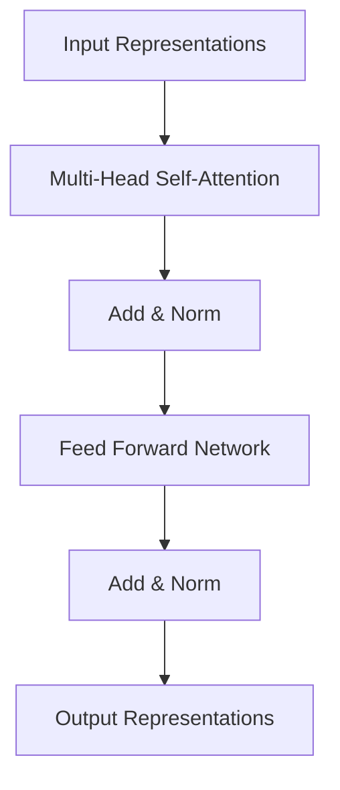
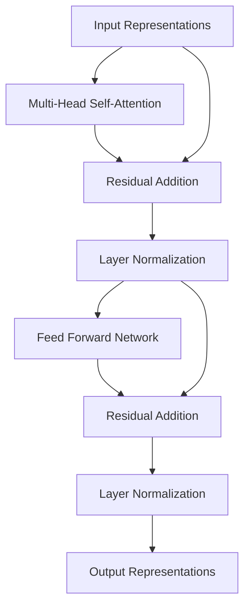
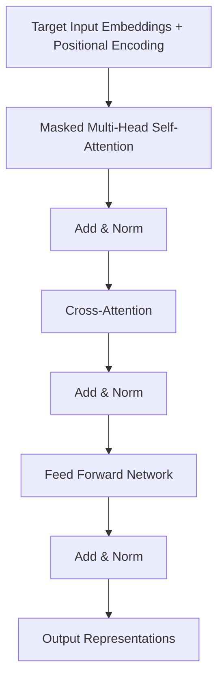
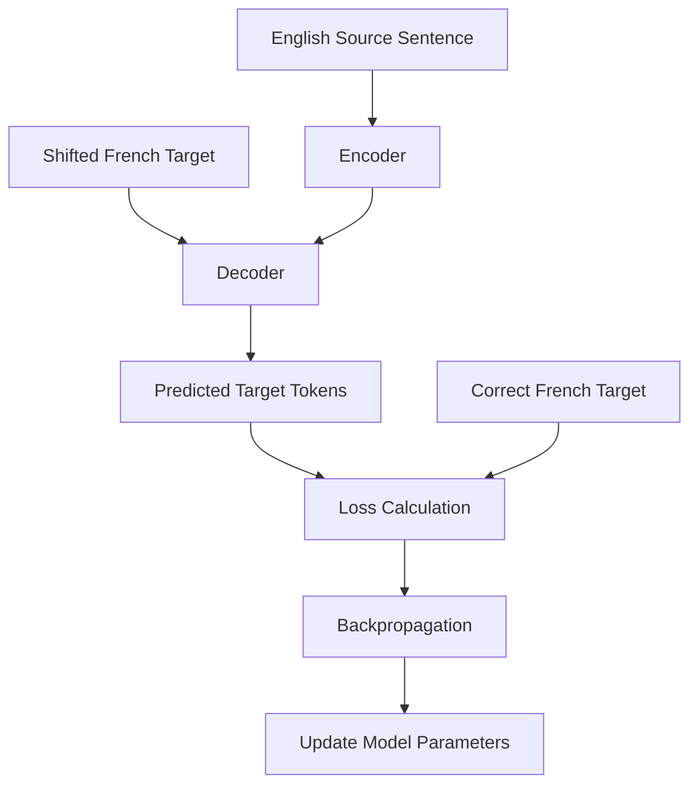

# Transformer Architecture – Complete Learning Notes

> A detailed guide to understanding the original Encoder–Decoder Transformer architecture, its internal components, attention mechanisms, training process, and inference.

---

## Table of Contents

1. [Introduction to Transformers](#1-introduction-to-transformers)
2. [Overall Transformer Architecture](#2-overall-transformer-architecture)
3. [Input Embeddings and Positional Encoding](#3-input-embeddings-and-positional-encoding)
4. [Encoder Architecture](#4-encoder-architecture)
5. [Self-Attention Mechanism](#5-self-attention-mechanism)
6. [Query, Key and Value](#6-query-key-and-value)
7. [Scaled Dot-Product Attention](#7-scaled-dot-product-attention)
8. [Multi-Head Attention](#8-multi-head-attention)
9. [Add & Layer Normalization](#9-add--layer-normalization)
10. [Feed Forward Network](#10-feed-forward-network)
11. [Decoder Architecture](#11-decoder-architecture)
12. [Masked Multi-Head Self-Attention](#12-masked-multi-head-self-attention)
13. [Cross-Attention](#13-cross-attention)
14. [Encoder vs Decoder](#14-encoder-vs-decoder)
15. [Training vs Inference](#15-training-vs-inference)
16. [Autoregressive Text Generation](#16-autoregressive-text-generation)
17. [Linear Layer and Softmax](#17-linear-layer-and-softmax)
18. [Complete Translation Example](#18-complete-translation-example)
19. [Important Dimensions and Shapes](#19-important-dimensions-and-shapes)
20. [Final Revision Summary](#20-final-revision-summary)

---

# 1. Introduction to Transformers

The Transformer is a deep learning architecture introduced in the 2017 research paper **"Attention Is All You Need"** by Vaswani et al.

It was designed to process sequential data, particularly natural language, using attention mechanisms instead of recurrent processing.

### Why were Transformers introduced?

Before Transformers, architectures like RNNs and LSTMs were commonly used for sequence processing.

However, they had some limitations:

- Sequential processing made training slower.
- Long-range dependencies were difficult to capture.
- Information from earlier tokens could gradually become difficult to retain.
- Parallel processing was limited.

Transformers address these challenges using attention mechanisms.

### Advantages of Transformers

1. **Parallel processing:** Multiple tokens can be processed simultaneously during training.
2. **Long-range dependencies:** Attention helps capture relationships between distant tokens.
3. **Contextual understanding:** A token's representation can incorporate information from other tokens.
4. **Scalability:** The architecture can be stacked into multiple layers.

---

# 2. Overall Transformer Architecture

The original Transformer follows an **Encoder–Decoder architecture**.


The architecture contains two major components:

### Encoder
- Receives the source sentence.
- Understands relationships between tokens.
- Produces contextual representations for every input token.

### Decoder
- Receives previously generated target tokens.
- Uses information from the Encoder.
- Generates the target sentence one token at a time during inference.

### Original Transformer configuration

| Component | Number of layers |
|---|---:|
| Encoder | 6 |
| Decoder | 6 |
| Attention heads | 8 |
| Model dimension (`d_model`) | 512 |
| Feed Forward hidden dimension | 2048 |

**Important:** Six Encoder/Decoder layers do not mean six input or output tokens. They represent the depth of the network.

---

# 3. Input Embeddings and Positional Encoding

Transformers cannot directly understand words as text. They require numerical representations.

The input sentence first goes through tokenization and embedding.

Consider:

`I am a boy`

### Step 1: Tokenization

The sentence is divided into tokens.

Example:

```text
["I", "am", "a", "boy"]
```

Each token is mapped to a token ID.

### Step 2: Token Embeddings

Each token ID is converted into a numerical vector using an embedding layer.

For the original Transformer:

```text
d_model = 512
```

Therefore, each token receives a 512-dimensional embedding.

For four tokens:

```text
Input embedding matrix = 4 × 512
```

### Step 3: Positional Encoding

One important problem with Transformers is that they process tokens in parallel.

Unlike RNNs, they do not inherently know the order of the tokens.

For example:

```text
I am a boy
Boy am I a
```

The order changes the meaning.

To address this, positional information is added to token embeddings.

```text
Final Input Representation =
Token Embedding + Positional Encoding
```

The original Transformer uses sinusoidal positional encoding.

For even dimensions:

\[
PE(pos,2i)=\sin\left(\frac{pos}{10000^{2i/d_{model}}}\right)
\]

For odd dimensions:

\[
PE(pos,2i+1)=\cos\left(\frac{pos}{10000^{2i/d_{model}}}\right)
\]

After adding positional encoding:

```text
Input representation = 4 × 512
```

Each token now has both semantic and positional information.

---

# 4. Encoder Architecture

The Encoder consists of six identical layers stacked together in the original Transformer.

Each Encoder layer contains two main sublayers:

1. Multi-Head Self-Attention
2. Feed Forward Network

Each sublayer also uses a residual connection and Layer Normalization.

### Encoder Layer Architecture



### Detailed explanation

1. Input representations are passed to Multi-Head Self-Attention.
2. Attention calculates relationships between tokens.
3. Add & Norm combines the original input with the attention output and normalizes it.
4. The result enters the Feed Forward Network.
5. Add & Norm is applied again.
6. The resulting representations are passed to the next Encoder layer.

After six Encoder layers, we obtain the final contextual representations of the source sentence.

**Important:** The Encoder does not produce one single representation for the entire sentence. It produces one contextual representation for every input token.

For example:

```text
Input: I am a boy

Encoder output:
Representation of I
Representation of am
Representation of a
Representation of boy
```

For four tokens:

```text
Encoder output = 4 × 512
```

These representations are supplied to the Decoder's Cross-Attention layers.

---

# 5. Self-Attention Mechanism

Self-Attention helps a token understand its relationship with other tokens in the same sequence.

Consider:

`The boy is playing football because he loves it.`

To understand the meaning of `he`, the model needs information from `boy`.

Self-Attention allows the model to capture such relationships.

### How Self-Attention works

1. Each token is transformed into Query, Key and Value vectors.
2. Query and Key are used to calculate attention scores.
3. Softmax converts scores into attention weights.
4. Attention weights are multiplied by Value vectors.
5. The result is a contextual representation for each token.

The attention mechanism determines how much information each token should receive from other tokens.

---

# 6. Query, Key and Value

The attention mechanism uses three important components:

- Query (Q)
- Key (K)
- Value (V)

They are generated from the input representations using learned weight matrices.

Let the input representation be `X`.

```text
Q = X × WQ
K = X × WK
V = X × WV
```

### Query (Q)

Represents what information the current token is looking for.

### Key (K)

Represents the information against which a Query is compared.

### Value (V)

Contains the information that gets combined according to the attention weights.

### Simple analogy

Imagine searching for a particular book in a library.

- Query: What book am I looking for?
- Key: Information on each book's catalogue entry.
- Value: The actual information/content associated with each book.

The Query and Key determine relevance, while Value provides the information to retrieve.

**Important:** Q, K and V are learned transformations of the input representations. They are not simply the original embeddings.

---

# 7. Scaled Dot-Product Attention

Once Q, K and V are generated, the attention calculation begins.

The original Transformer uses Scaled Dot-Product Attention.

### Step 1: Calculate Attention Scores

Multiply Query with the transpose of Key.

\[
Scores = QK^T
\]

This measures how much attention each Query assigns to each Key.

### Step 2: Scaling

The scores are divided by the square root of the Key dimension.

\[
ScaledScores = \frac{QK^T}{\sqrt{d_k}}
\]

Scaling helps prevent excessively large dot-product values that can make Softmax gradients very small.

### Step 3: Apply Softmax

Softmax converts the scores into attention weights.

\[
AttentionWeights =
Softmax\left(\frac{QK^T}{\sqrt{d_k}}\right)
\]

Each row of the attention weight matrix sums to 1.

### Step 4: Multiply by Value

The attention weights are multiplied by the Value matrix.

\[
AttentionOutput =
Softmax\left(\frac{QK^T}{\sqrt{d_k}}\right)V
\]

This produces the contextual representation for each token.

### Complete formula

\[
\boxed{
Attention(Q,K,V)=
Softmax\left(\frac{QK^T}{\sqrt{d_k}}\right)V
}
\]

### Important distinction

| Operation | Meaning |
|---|---|
| \(QK^T\) | Attention scores |
| Softmax of scores | Attention weights |
| Attention weights × V | Attention output |

**Remember:** Attention weights determine how much information to take, and Value contains the information being combined.

---

# 8. Multi-Head Attention

Instead of performing attention only once, the Transformer performs attention multiple times using different learned projections.

This is called Multi-Head Attention.

The original Transformer uses eight attention heads.

### Why multiple heads?

Different heads can learn different relationships between tokens.

For example, in:

`The boy is playing football`

Different heads may learn to focus on:

- Subject relationships.
- Verb relationships.
- Contextual relationships.
- Other linguistic patterns.

These are possible learned patterns, not fixed rules assigned to individual heads.

### Multi-Head Attention process

Assume:

```text
Input tokens = 4
d_model = 512
Number of heads = 8
d_head = 64
```

Each head receives the same input representation but uses its own learned projection matrices.

For each head:

\[
Q_i=XW_{Q_i}
\]

\[
K_i=XW_{K_i}
\]

\[
V_i=XW_{V_i}
\]

Each head produces:

```text
Q = 4 × 64
K = 4 × 64
V = 4 × 64
```

### Step-by-step process

**Step 1:** Each head independently generates Q, K and V.

**Step 2:** Each head calculates attention scores.

\[
Scores=QK^T
\]

For four tokens:

```text
Attention score matrix = 4 × 4
```

Every token's Query is compared with the Keys of the available tokens.

**Step 3:** Apply Softmax to obtain attention weights.

```text
Attention weights = 4 × 4
```

**Step 4:** Multiply attention weights with V.

\[
Output=AttentionWeights\times V
\]

```text
Output of one head = 4 × 64
```

**Step 5:** Concatenate all eight heads.

```text
8 × (4 × 64)
```

The concatenated output becomes:

```text
4 × 512
```

**Step 6:** Apply the final output projection matrix.

\[
MultiHead(Q,K,V)=Concat(head_1,\ldots,head_8)W_O
\]

The final output shape remains:

```text
4 × 512
```

### Important clarification

The original 512-dimensional embedding is not physically split into eight pieces before attention.

Each head uses its own learned projection matrices to produce 64-dimensional Q, K and V vectors.

---

# 9. Add & Layer Normalization

After Multi-Head Attention, the Transformer uses a residual connection followed by Layer Normalization.

This is commonly called Add & Norm.

### Why do we add the original input?

Consider:

```text
Original input = X
Attention output = Attention(X)
```

The attention output contains contextual information gathered from other tokens.

The original input contains the token's initial information and positional information.

We add both:

\[
Y=X+Attention(X)
\]

This is called a residual connection or skip connection.

### Benefits of residual connections

1. Preserve a direct path for the original input information.
2. Help gradients flow through deep networks.
3. Make deeper architectures easier to train.

### Layer Normalization

After addition, Layer Normalization is applied.

\[
Output=LayerNorm(X+Attention(X))
\]

Layer Normalization normalizes feature values for each token across its hidden dimensions.

It uses learnable parameters:

- Gamma (\(\gamma\)): Scale
- Beta (\(\beta\)): Shift

Its purpose is to stabilize the distribution of activations and improve training.

**Important distinction:**

- Residual connection adds the original input.
- Layer Normalization normalizes feature values.
- Softmax converts attention scores into probability-like attention weights.

They perform different operations.

The original Transformer uses Post-Layer Normalization, meaning normalization happens after the residual addition.

---

# 10. Feed Forward Network

After the first Add & Norm, the representation enters the Feed Forward Network (FFN).

The FFN processes each token representation independently using the same learned network.

Unlike Self-Attention, it does not directly mix information between different token positions.

### Architecture

The original Transformer uses two linear transformations with a ReLU activation in between.

\[
FFN(x)=max(0,xW_1+b_1)W_2+b_2
\]

### Original dimensions

```text
Input dimension = 512
Hidden dimension = 2048
Output dimension = 512
```

The processing is:

```text
512 → 2048 → ReLU → 512
```

### Why use FFN?

Attention combines information from different tokens.

The Feed Forward Network further transforms the resulting token representations and learns useful nonlinear patterns.

After the FFN, another residual connection and Layer Normalization are applied.

\[
Output=LayerNorm(X+FFN(X))
\]

Here, X represents the input to that FFN sublayer.

### Complete Encoder layer



---

# 11. Decoder Architecture

The Decoder is responsible for generating the target sequence.

The original Transformer contains six Decoder layers.

Unlike the Encoder, each Decoder layer contains three main sublayers:

1. Masked Multi-Head Self-Attention
2. Encoder–Decoder Cross-Attention
3. Feed Forward Network

Each sublayer uses Add & Norm.

### Decoder layer architecture



The Decoder has two different attention mechanisms:

- Masked Self-Attention: Looks at available target tokens.
- Cross-Attention: Uses information from the Encoder's output.

---

# 12. Masked Multi-Head Self-Attention

The Decoder uses Masked Multi-Head Self-Attention to prevent future target tokens from being accessed.

### Why is masking required?

Consider the target sentence:

```text
Je suis un garçon
```

During training, the Decoder receives a shifted version of the target sequence:

```text
Input:    BOS  Je   suis  un
Expected: Je   suis un    garçon
```

The model must predict the next token at every position.

If the first position can access all future tokens, it could directly see the answer.

This would cause information leakage during training.

### Causal Masking

The causal mask prevents a token from attending to future positions.

For example:

```text
                 BOS   Je   suis   un

BOS               ✓     ✗     ✗     ✗
Je                ✓     ✓     ✗     ✗
suis              ✓     ✓     ✓     ✗
un                ✓     ✓     ✓     ✓
```

The first token can only attend to itself.

The second token can attend to BOS and Je, but cannot access suis or un.

### Why is this important?

It ensures that the Decoder learns to predict the next token using only previously available target tokens.

During inference, future tokens do not exist yet. However, the causal attention mechanism remains part of the Decoder architecture.

---

# 13. Cross-Attention

Cross-Attention connects the Encoder and Decoder.

It allows the Decoder to access information from the original source sentence while generating the target sentence.

Consider:

```text
English: I am a boy
French:  Je suis un garçon
```

The Encoder processes the English sentence and produces contextual representations.

These representations are passed to the Cross-Attention layer in the Decoder.

### Where do Q, K and V come from?

This is one of the most important distinctions in the Transformer architecture.

In Cross-Attention:

- Query comes from the Decoder.
- Key comes from the Encoder.
- Value comes from the Encoder.

Let:

```text
Decoder representation = D
Encoder output = E
```

The Cross-Attention layer creates:

\[
Q=DW_Q
\]

\[
K=EW_K
\]

\[
V=EW_V
\]

The Encoder does not directly send separately calculated K and V matrices for Cross-Attention.

It sends its final contextual representations. The Cross-Attention layer transforms those representations into K and V using learned projection matrices.

### Cross-Attention calculation

Once Q, K and V are generated, the same Scaled Dot-Product Attention formula is used:

\[
Attention(Q,K,V)=
Softmax\left(\frac{QK^T}{\sqrt{d_k}}\right)V
\]

### Understanding with a translation example

Imagine a human translator.

The translator has the English sentence on one side and is writing the French translation on the other.

Whenever the translator needs information, they look back at the English sentence.

Similarly:

- Query asks what information is needed.
- Key helps determine which source representations are relevant.
- Value provides the information to combine.

For example, when generating the first French token, the Decoder uses Cross-Attention to access relevant information from the Encoder's representation of the English sentence.

**Important:** Cross-Attention does not simply map one English word to one French word. It uses contextual information from the source sentence to help generate the target sequence.

---

# 14. Encoder vs Decoder

| Feature | Encoder | Decoder |
|---|---|---|
| Main purpose | Understand input | Generate output |
| Self-Attention | Normal Multi-Head Self-Attention | Masked Multi-Head Self-Attention |
| Cross-Attention | No | Yes |
| Feed Forward Network | Yes | Yes |
| Add & Norm | Yes | Yes |
| Original number of layers | 6 | 6 |

### Attention differences

**Encoder Self-Attention:**

Q, K and V are all generated from Encoder representations.

\[
Q=XW_Q,\quad K=XW_K,\quad V=XW_V
\]

**Decoder Masked Self-Attention:**

Q, K and V are generated from Decoder representations, with causal masking applied to prevent access to future target tokens.

**Decoder Cross-Attention:**

Q comes from Decoder representations, while K and V come from Encoder representations.

---

# 15. Training vs Inference

Training and inference are two different phases of the Transformer.

## Training Phase

During training, both the source sentence and the correct target sentence are available.

Example:

```text
English: I am a boy
French:  Je suis un garçon
```

### Encoder input

```text
I am a boy
```

The Encoder processes the entire English sentence and produces contextual representations.

### Decoder input

The correct French sentence is shifted right by one position.

```text
Decoder input:  BOS Je suis un
Expected output: Je  suis un garçon
```

This approach is called Teacher Forcing.

The Decoder uses Masked Self-Attention, Cross-Attention and FFN to generate predictions.

### Loss calculation

The predicted tokens are compared with the correct target tokens using a loss function, commonly cross-entropy loss.

The loss is used for backpropagation to update the trainable weights of the Encoder and Decoder.



## Inference Phase

During inference, we only provide the source sentence.

We do not provide the correct target sentence.

For example:

```text
Input: I am a boy
```

The Encoder processes the English sentence.

The Decoder initially receives only the BOS token.

It generates the output one token at a time.

No target sentence is supplied, and the model's weights are not updated.

---

# 16. Autoregressive Text Generation

Autoregressive generation means that the model predicts one token at a time and uses previously generated tokens to predict subsequent tokens.

Let's understand this using our translation example.

```text
English: I am a boy
```

Expected French translation:

```text
Je suis un garçon
```

### Step 1: First prediction

Decoder input:

```text
BOS
```

The token passes through all six Decoder layers.

The Decoder uses:

1. Masked Self-Attention
2. Cross-Attention
3. Feed Forward Network

The final Decoder representation is sent to Linear + Softmax.

Prediction:

```text
Je
```

### Step 2: Second prediction

The generated token is appended to the previous Decoder input.

```text
BOS Je
```

The sequence passes through all six Decoder layers again.

The last position's representation is used to predict the next token.

Prediction:

```text
suis
```

### Step 3: Third prediction

```text
BOS Je suis
```

Prediction:

```text
un
```

### Step 4: Fourth prediction

```text
BOS Je suis un
```

Prediction:

```text
garçon
```

### Step 5: Termination

The Decoder continues generating tokens until it produces a special token called EOS (End of Sequence).

```text
BOS → Je → suis → un → garçon → EOS
```

Once EOS is generated, the generation process stops.

### Important clarification about Decoder layers

Every generated token passes through all six Decoder layers.

The six layers represent the depth of the network, not the number of tokens it can generate.

For example:

| Generation step | Decoder input | Output prediction |
|---|---|---|
| 1 | BOS | Je |
| 2 | BOS Je | suis |
| 3 | BOS Je suis | un |
| 4 | BOS Je suis un | garçon |

The Decoder can generate sentences of different lengths. It is not restricted to six words.

---

# 17. Linear Layer and Softmax

After the final Decoder layer, the resulting representations are passed through a Linear layer.

The Linear layer projects the Decoder's hidden representation into the vocabulary dimension.

For example:

```text
Decoder hidden dimension = 512
Vocabulary size = 30,000
```

The Linear layer transforms:

```text
512 → 30,000
```

The resulting values are called logits.

### Softmax

Softmax converts logits into probabilities.

\[
Softmax(z_i)=\frac{e^{z_i}}{\sum_j e^{z_j}}
\]

Example:

| Token | Probability |
|---|---:|
| Je | 0.75 |
| Tu | 0.10 |
| Il | 0.08 |
| Other tokens | 0.07 |

The model then selects a token according to its decoding strategy.

The selected token is appended to the Decoder input for the next generation step.

**Important:** During inference, the final representation at the last available Decoder position is used to predict the next token. During training, predictions are produced for all target positions in parallel.

---

# 18. Complete Translation Example

Let's combine everything we have learned.

### Input

```text
English: I am a boy
French:  Je suis un garçon
```

### Complete architecture

```mermaid
flowchart TD
    A[English Input: I am a boy] --> B[Tokenization]
    B --> C[Embedding + Positional Encoding]
    C --> D[Encoder Layer 